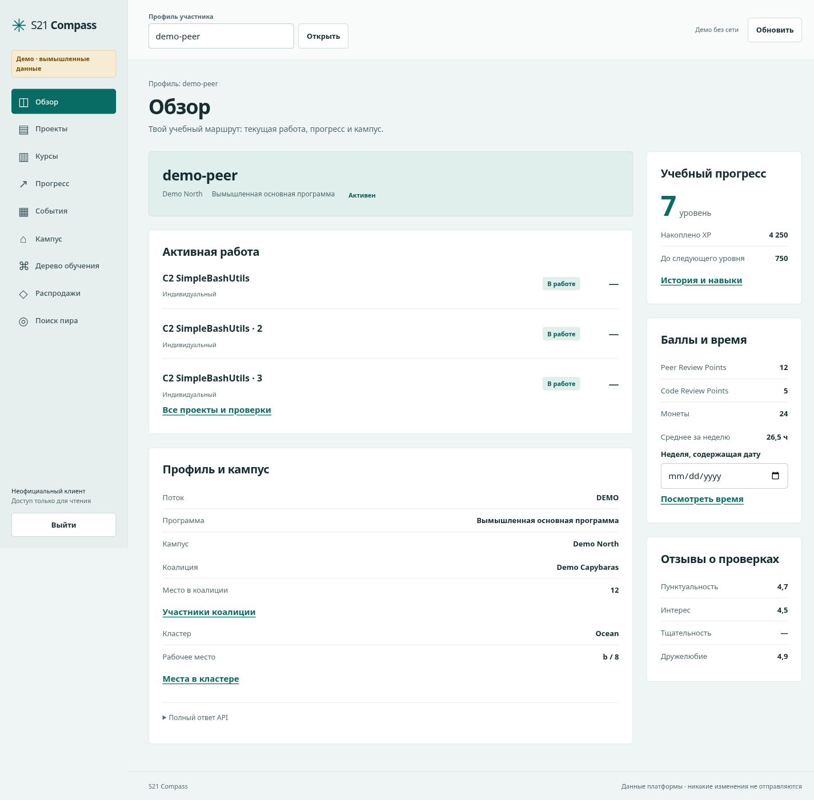
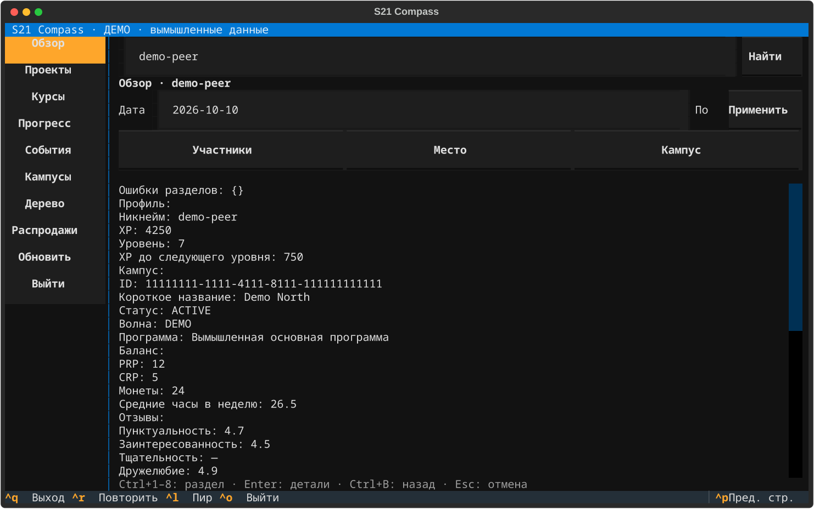

# S21 Compass

Неофициальный клиент **Школы 21 (Сбер)**: интерактивный терминал и самостоятельный
веб-кабинет на одном клиенте официального API.



<details>
<summary>Интерфейс в терминале — вымышленные демо-данные</summary>



</details>

## Установка

Нужен Python 3.11 или новее. Скачать исходники:

```sh
git clone https://github.com/kissabmi/s21-compass.git
cd s21-compass
```

Затем из каталога проекта:

```sh
python -m venv .venv
source .venv/bin/activate
python -m pip install .
```

В Windows активация: `.venv\Scripts\activate`. Если установлен uv:

```sh
uv sync
```

## Запуск

```sh
s21-compass tui
s21-compass tui --demo
s21-compass web
```

С uv добавьте `uv run` перед командой. Веб-кабинет доступен по адресу, который
команда напечатает при запуске; по умолчанию `http://127.0.0.1:8210`.
Остановка — `Ctrl+C`.

Введите учётные данные платформы в форме входа и укажите **nickname участника**.
Учётная запись для входа и nickname могут различаться. Демо можно открыть без
аккаунта; все его данные вымышлены и помечены.

### Управление в терминале

- `Ctrl+1` … `Ctrl+8` — переключить раздел; `Tab` — перейти к элементу управления.
- `Enter` на строке — подробности; `Ctrl+B` — назад.
- `Ctrl+N` / `Ctrl+P` — следующая / предыдущая страница списка.
- `Ctrl+L` — поиск пира; `Ctrl+R` — обновить или повторить запрос.
- `Ctrl+O` — выйти из аккаунта; `Ctrl+Q` — закрыть приложение.

Минимальный размер терминала — 80×24. Для подробных таблиц удобнее 120×36.

В браузере все основные разделы доступны в навигации, а подробности открываются
по нажатию на проект, курс, пира или место. `Escape` закрывает окно подробностей.

## Возможности

- Профиль, уровень и XP, PRP/CRP/монеты, средний недельный logtime, feedback.
- Проекты и курсы: статусы, страницы списка, подробности.
- История XP, навыки, значки и коалиция.
- События за выбранный период.
- Кампусы, кластеры, занятые и свободные места, участники.
- Дерево проектов, распродажи, просмотр пира по точному nickname.

Клиент использует GET-возможности [School21 OpenAPI](https://platform.21-school.ru/docs).
Авторизация — официальный Keycloak `s21-open-api`. Пароли и токены не сохраняются
на диск и не кладутся в хранилище браузера. Веб-сессии живут в памяти локального
процесса; после его остановки нужно войти снова. Это локальный кабинет, не сервис
для размещения чужих аккаунтов на публичном сервере.

## Проверки и разработка

```sh
uv sync --extra dev
uv run pytest
uv run ruff check .
```

Автоматические проверки используют mock HTTP и явно обозначенное демо.
**Успешный вход в реальный аккаунт School21 ещё не проверен:** это требует
локального ввода настоящих учётных данных. Доступность OIDC и unauthenticated
401 проверены отдельно. API может менять схему и правила доступа.

Пакет проверен после установки в отдельное окружение Python 3.11, интерфейс —
в настоящем браузере на ширинах 1440 и 375 px. Проверки включают обновление токена,
изоляцию сессий, CSRF, пагинацию, частичные ошибки и запоздалые ответы.

## Найденные альтернативы

- [s21cli](https://github.com/s21toolkit/s21cli) — терминальные CLI-команды,
  внутренний GraphQL; MIT.
- [Watchman](https://github.com/rafikov/watchman) — браузерные инструменты,
  карта кампуса, пиры и дерево; Apache-2.0.
- [School 21 Portal](https://github.com/Amazomic/s21_helper_front) — React dashboard;
  требует отдельно настроенных proxy/backend.

S21 Compass — самостоятельная реализация; код этих проектов не заимствован.
Проект не связан официально со Сбером или Школой 21. Лицензия [MIT](LICENSE).
